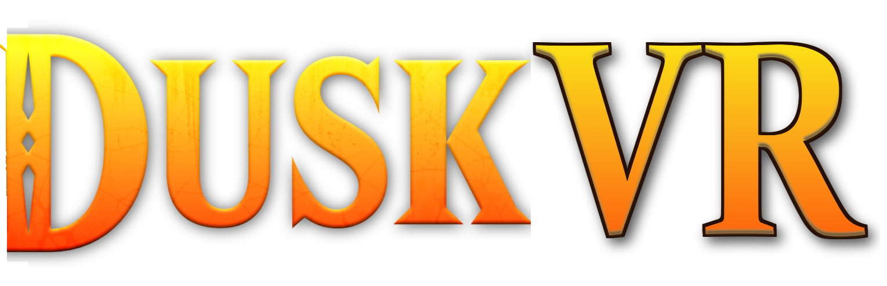

<div align="center">
  

  <p><b>Step inside Hyrule.</b> A full-body, 6DoF virtual reality mode for
  <a href="https://github.com/TwilitRealm/dusklight">Dusklight</a>, built into the engine.</p>

  <p>
    <a href="docs/vr.md">VR guide</a>
    •
    <a href="#building">Build</a>
    •
    <a href="#controls">Controls</a>
    •
    <a href="docs/dusklight-README.md">About Dusklight</a>
  </p>
</div>

> [!IMPORTANT]
> DuskVR is an unofficial fan project and is not affiliated with Nintendo or with the Dusklight
> team. It contains no game assets: you need your own legally dumped copy of the original game, as
> with Dusklight.

## What it is

DuskVR renders the game for each eye at your headset's native resolution and refresh rate, and
puts you in the body instead of behind it:

- **First person inside your own body.** Look down and see your chest, arms and legs. Your head
  drives Link's head, neck and spine; your hands reach out through two-bone arm IK; your feet stay
  planted while you lean and step when you walk. A third-person view is one click away.
- **Motion controls.** Swing the sword, thrust to stab, spin to spin-attack. Raise your shield to
  guard, punch with it to bash. Draw the bow by pulling the string. Point to aim the clawshot,
  boomerang and Dominion Rod. Toss what you carry.
- **Your body moves you.** Walk around your room, crouch for real, climb ladders and vines with
  your hands, swim with arm strokes, snap the reins to spur Epona.
- **Fingers.** On Valve Index controllers your fingers open, curl and pinch Link's hands.
- **Wolf Link** in first person on all fours, clawing, biting with a lunge, digging with your hands.
- **A HUD that floats.** Hearts, items, text and every menu (the game's and Dusklight's) live on a
  panel in front of you; point and click with a laser.
- **Made for comfort.** Snap or smooth turning, head-relative movement, optional vignette, no idle
  animations or walk-cycle head bob in first person.
- **Made for streaming.** The desktop window is a clean 16:9 view: your headset view, a smoothed
  first-person camera, a third-person camera that shows your whole body, or a selfie camera.

## Requirements

- Windows with an OpenXR runtime that supports D3D12 (SteamVR, Meta Quest Link, Virtual Desktop,
  Windows Mixed Reality). Developed on SteamVR with a Valve Index.
- A GPU that runs Dusklight on D3D12. VR switches the game to D3D12 automatically.
- Your own dump of the game (see [Dusklight's setup notes](docs/dusklight-README.md)).

## Building

```sh
git clone --recurse-submodules https://github.com/odinong/duskvr.git
cd duskvr
git -C extern/aurora apply ../../patches/aurora-vr.patch
cmake --preset windows-msvc-relwithdebinfo
cmake --build --preset windows-msvc-relwithdebinfo
```

Then start your headset's runtime and run
`build/windows-msvc-relwithdebinfo/dusklight.exe --dvd <your disc image>`. Without a headset it
plays flat, like Dusklight.

## Controls

The controllers show up in Dusklight's Input menu as a gamepad (e.g. "Valve Index Controllers
(VR)") and can be rebound there. Defaults, sword in the right hand:

| | |
| --- | --- |
| Left stick | Move where you look |
| Right stick | Turn (click: switch first/third person, hold: recenter) |
| Swing / thrust / circle | Sword attacks / stab / spin attack |
| Raise the left hand | Lock on and guard |
| Right trigger | B · laser click in menus |
| A / B | A / Z (Midna) |
| X / Y | X / Y items |
| Left trigger / left grip | L / R |
| Menu | Tap: Start · hold: Dusklight menu |

The [VR guide](docs/vr.md) covers every gesture, item and setting, and how it all works.

## Credits

DuskVR is a fork of [Dusklight](https://github.com/TwilitRealm/dusklight) by Twilit Realm, which
is built on the [Twilight Princess decompilation](https://github.com/zeldaret/tp) and the
[Aurora](https://github.com/encounter/aurora) runtime. All of the game reimplementation is their
work; DuskVR adds the VR layer on top. Released under the same license as Dusklight
([CC0](LICENSE.md)).
